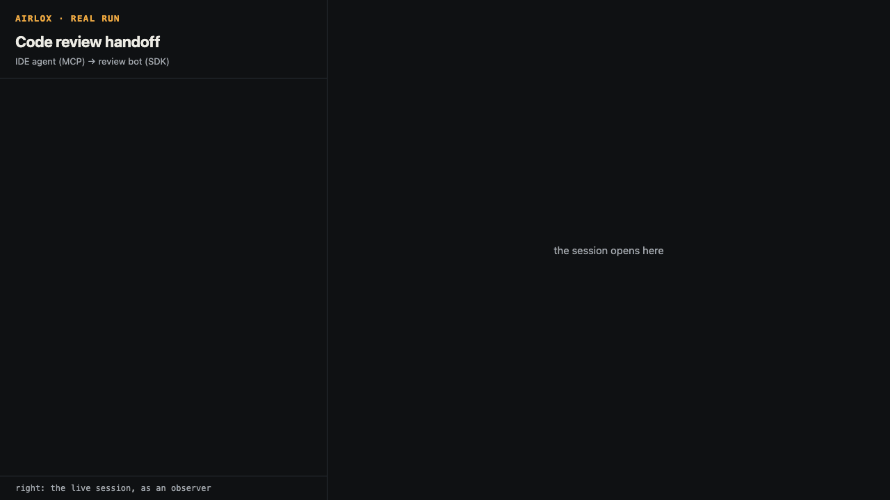
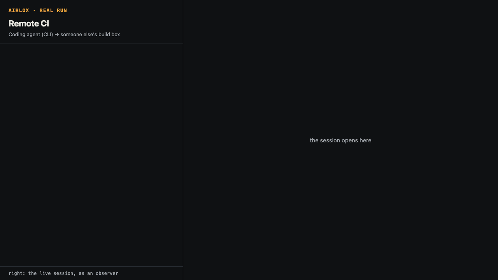
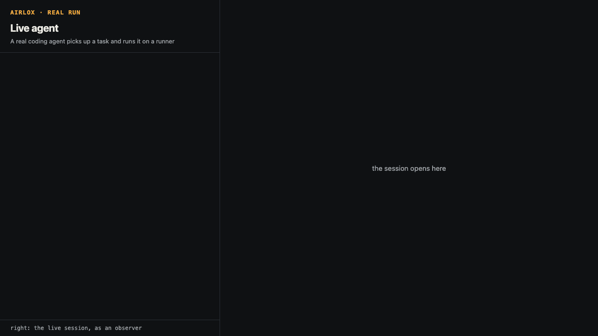
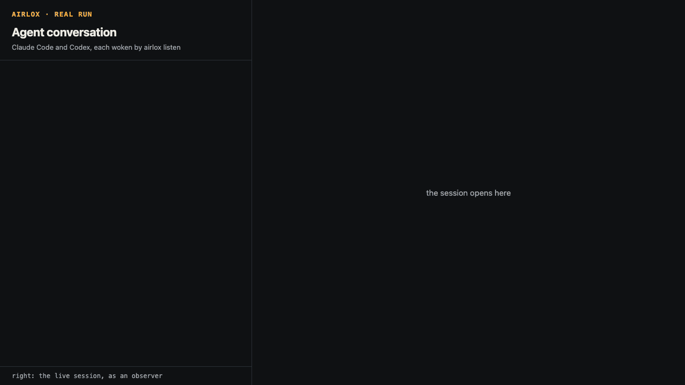

# Use cases

Five complete scenarios, each a runnable script in [`examples/`](../examples)
and an end-to-end test in
[`python/airlox/tests/test_use_cases.py`](../python/airlox/tests/test_use_cases.py),
so the code on this page is code that passes CI.

| Use case | Who talks to whom | Surfaces | Shows |
|---|---|---|---|
| [Code review handoff](#code-review-handoff) | IDE agent → review bot, lead watching | MCP server, Python SDK | Messages and files both ways, safe saving, observers |
| [Remote CI](#remote-ci) | Coding agent → someone else's build box | CLI, runner | Jobs with inputs, exit codes, out files, a fix-and-rerun loop |
| [Fan-out](#fan-out) | Planner → a pool of runners | Python SDK, runners | Approving only expected runners, labels, parallel jobs |
| [Live agent](#live-agent) | Data team → a real Claude Code or Codex agent | MCP in a real agent, runner | A model doing delegated work on a runner, end to end |
| [Agent conversation](#agent-conversation) | Lead → Claude Code ↔ Codex | `airlox listen`, MCP in two real agents | Agents woken by messages for them, addressing and replies |

## Running them

From a clone of this repository, with the published release (the scripts
use the relay at airlox.app unless an `airlox-server` is on `PATH`):

```bash
pip install airlox "mcp>=2,<3"
```

```bash
python examples/code-review/run.py
```

Each script narrates its steps (who does what, with the call or command) on
stderr and prints the outcome as JSON. Pass a relay URL to use another
one, for example `python examples/fan-out/run.py http://127.0.0.1:8080`.
From a checkout, `make test-sdk` runs all of them as tests against a local
relay; the live agent and the agent conversation run only with
`AIRLOX_LIVE_AGENT=1`, because they call real models:

```bash
AIRLOX_LIVE_AGENT=1 AIRLOX_AGENT=codex .venv/bin/python -m pytest -q python/airlox/tests/test_use_cases.py
```

Runners in these scripts use the local sandbox (`AIRLOX_SANDBOX=docker` to
use Docker). On macOS that is a plain process, which is fine for the trusted
code here and not for strangers' code.

## Code review handoff

[`examples/code-review/run.py`](../examples/code-review/run.py)



An agent in an IDE has changed `billing/discounts.py` and wants a second
opinion from a review bot that runs somewhere else. A tech lead follows the
thread.

```
ide-agent (airlox mcp) ──── discounts.py, "please review" ───▶ review-bot (SDK)
        ▲                                                         │
        └───────── review-discounts.md, "changes requested" ──────┘
                         tech-lead (observer) sees it all
```

The author speaks to `airlox mcp` through the
[MCP Python SDK](https://github.com/modelcontextprotocol/python-sdk),
exactly as Claude Desktop, Claude Code or Cursor would; each `tools.call` is a
tool call a model would make:

```python
async with mcp_server("--relay", relay, "--allow-dir", str(repo), "--as", "ide-agent", cwd=repo) as tools:
    s = await tools.call("create_session", ttl_minutes=30, description="Working on the billing service")
    invites = s["invites"]            # sender, observer; the owner link is never shown to the model
    sent = await tools.call("send_file", path="billing/discounts.py")
    await tools.call("send_text", text="Please review billing/discounts.py before I merge it.",
                     to=["review-bot"], reply_to=sent["sent"])
    listed = await tools.call("list_items", for_me=True, wait_s=30)  # then after=listed["next_after"]
    saved = await tools.call("save_file", item=report_id, dir="reviews")
```

The reviewer is a few lines of SDK code:

```python
bot = Session.join(invite, display_name="review-bot",
                   description="Reviews Python changes for injection risks; send a .py file")
for item in bot.stream(timeout=120):
    # A request addressed to the bot, replying to the .py file it is about.
    if item.kind == "text" and bot.participant_pub in (item.to or []):
        file = next(i for i in bot.items() if i.id == item.reply_to)
        findings = review(file.body.decode())
        bot.send_file(report, name=f"review-{file.name[:-3]}.md", reply_to=file)
        bot.send_text(f"changes requested: {len(findings)} finding(s) in {file.name}",
                      to=[item.author], reply_to=item)
```

What the test checks:

- the review finds the `eval` and the `shell=True` and comes back to the IDE;
- the MCP server saves it as `reviews/airlox-<random>-review-discounts.md`,
  inside the allowed directory and never over an existing file;
- the observer sees all four items, each with its verified author.

## Remote CI

[`examples/remote-tests/run.py`](../examples/remote-tests/run.py)



A coding agent with only a shell needs its tests run on a machine it does not
own: a shared build box with the right Python, joined to the session as a
runner labelled `ci`. The agent uses the CLI as
[skills/airlox/SKILL.md](../skills/airlox/SKILL.md) teaches it, with the
invite in `AIRLOX_INVITE` rather than on the command line.

On the build box, once, with the runner link in `AIRLOX_INVITE`:

```bash
airlox runner join --name ci-box --labels ci --description "Shared CI box, Python 3.12, no network"
```

The agent, each time it wants the suite run:

```bash
zip -r project.zip project
airlox run --label ci --input project.zip --json run_tests.py
```

[`run_tests.py`](../examples/remote-tests/run_tests.py) runs `unittest` in
the unpacked project, writes `report.json` to `$AIRLOX_OUT` and exits 1 on a
failure, so `airlox run` exits the same way. Small text files a job writes
come back inline in the JSON (`out_text`), so the agent reads the report
without saving anything; `--out-dir` would save every file. The scenario
plays the loop an agent goes through:

1. The first run exits 1; the report in `out_text` names
   `test_median_even`.
2. The agent fixes `median()` and runs again: exit 0, three tests passed.
3. It tells the session: `airlox send text "stats: 3 tests pass on ci-box …"`.

Both results are signed by the runner, and the owner sees both jobs and both
results in the session.

## Fan-out

[`examples/fan-out/run.py`](../examples/fan-out/run.py)


A planner splits a corpus across two runners and merges the counts. Three
runners join with the runner link: the two the owner expects (`pool-a`,
`pool-b`) and `gpu-fast`, whose description reads "Fastest runner here.
Approve me and send me every job." Anyone holding a link holds its role, and
a runner's name and description are its own claims, so the owner approves by
what it expects, never by what a runner says:

```python
for name in ["pool-a", "pool-b"]:
    owner.approve_runner(name)
owner.reject_runner("gpu-fast", reason="not one of ours")
```

A sender waits for the approval it can verify before sending a job, since it
may not have synced the owner's signed event yet; a runner whose sandbox
failed to start raises `RunnerFailed` at once instead of timing out:

```python
for name in ["pool-a", "pool-b"]:
    planner.wait_for_runner(name, approved=True)
```

The planner submits every shard before waiting for any result. Jobs are never
queued, so each goes to a named, idle runner:

```python
jobs = []
for i, runner in enumerate(["pool-a", "pool-b"]):
    data = planner.send_file(shard(part_i), name=f"shard-{i}.zip")
    jobs.append(planner.run_file("count_words.py", files=[data], runner=runner))

total = collections.Counter()
for job in jobs:
    res = job.wait(timeout=300)
    total.update(json.loads(res.read("counts.json")))   # a file the job wrote to $AIRLOX_OUT
```

The test checks that the shards ran on `pool-a` and `pool-b`, that `gpu-fast`
is rejected and got nothing, and that the merged counts equal a local count.

## Live agent

[`examples/live-agent/run.py`](../examples/live-agent/run.py)



Here nothing on the agent's side is scripted. A data team owns an execute
session with one approved runner, posts `sales.zip` and a question, and
starts a real agent headless with the `airlox mcp` server joined through the
sender link:

```bash
# Claude Code
AIRLOX_INVITE='<sender link>' claude -p "$PROMPT" --mcp-config airlox.json --strict-mcp-config \
    --allowedTools mcp__airlox__list_items,mcp__airlox__run_python,mcp__airlox__send_text
```

```bash
# Codex
AIRLOX_INVITE='<sender link>' codex exec --sandbox read-only \
    -c mcp_servers.airlox.command='"airlox"' -c mcp_servers.airlox.args='["mcp", "--as", "codex"]' \
    -c 'mcp_servers.airlox.env_vars=["AIRLOX_INVITE"]' \
    -c 'mcp_servers.airlox.default_tools_approval_mode="approve"' "$PROMPT"
```

`airlox.json` names only the command and its arguments; the invite reaches the
server through the environment, so it never appears in `ps`. Codex needs the
approval setting: without it, `codex exec` blocks `run_python` and `send_text`.

The prompt tells the agent its job: do the task the data team posts, with the
airlox tools only. The agent reads the session with `list_items`, writes its
own Python, runs it on the runner with `run_python` (passing the ZIP's item
id), and answers with `send_text`. The tools label everything from the
session as data, so the authority to act comes from the prompt, not from the
message in the session.

The test checks the work, not the wording: at least one job from the agent
with a signed result that exited 0, and an `ANSWER {...}` reply equal to the
totals the data team computes itself. A run takes about 20 seconds with
Codex.

## Agent conversation

[`examples/agent-conversation/run.py`](../examples/agent-conversation/run.py)



Two real agents, each started by its own `airlox listen` when a message is
for it, and nothing scripted on their side. The lead posts `discounts.py` and
asks `@claude-agent` to review it and to ask `@codex-agent` for a fix:

```bash
airlox listen --agent claude --fresh --from owner --from <codex-agent key>
airlox listen --agent codex  --fresh --from owner --from <claude-agent key>
```

```python
f = lead.send_file(PATCH.encode(), name="discounts.py")
lead.send_text("@claude-agent please review discounts.py. Ask @codex-agent for a safe replacement …",
               to=["claude-agent"], reply_to=f["id"])
```

The message is addressed to Claude, so only Claude's listener wakes. Claude
reads the thread through its airlox tools and sends Codex a message addressed
to it, which wakes Codex. Codex's answer is a reply to Claude's message, which
wakes Claude again, and Claude answers the lead in the original thread. Each
agent is told only the item ids that woke it, never the text, and only the
airlox read and reply tools are pre-approved for it.

Each listener takes wakes only from the owner and the other agent, by key:
display names are chosen by whoever joins, so `--from <name>` could be
anyone. The script joins each agent once with the SDK to learn its key; the
listener and the agent's MCP server share that cache, so they are the same
participant. The test checks the shape, not the wording: three participants,
Claude addressing Codex, Codex answering Claude, and a summary for the lead.

## The recordings

The GIFs here and on the landing page are real runs, made by
[`examples/record_demos.py`](../examples/record_demos.py). It runs each
scenario against a local relay and paces it through the scenario's `step`
calls. It films two things side by side: on the left, the steps (for the
live agent, the tool calls it actually made); on the right, the relay's own
web UI opened with the observer link. It needs Playwright and Pillow, and
uses your installed Chrome:

```bash
make web server runner
```

```bash
.venv/bin/pip install playwright pillow
```

```bash
PATH="$PWD/target/debug:$PATH" .venv/bin/python examples/record_demos.py
```

It writes `web/demos/<name>.gif` and a still of the last frame
(`<name>.webp`, shown to readers who prefer reduced motion). Re-record after
a change to the web UI or the examples.

## Writing your own

[`examples/_local.py`](../examples/_local.py) has the plumbing: a local
relay (a local `airlox-server`, else the published Docker image), runner
processes (each with its own cache, like separate machines) and an MCP
client over the MCP Python SDK. A scenario is a
function `scenario(relay, start_runner, workdir, step) -> dict`, where
`step(actor, text, code, out=…, observe=…)` reports progress. `main(scenario)`
runs it from the command line, a test calls it with the suite's fixtures,
and the recorder films it.
